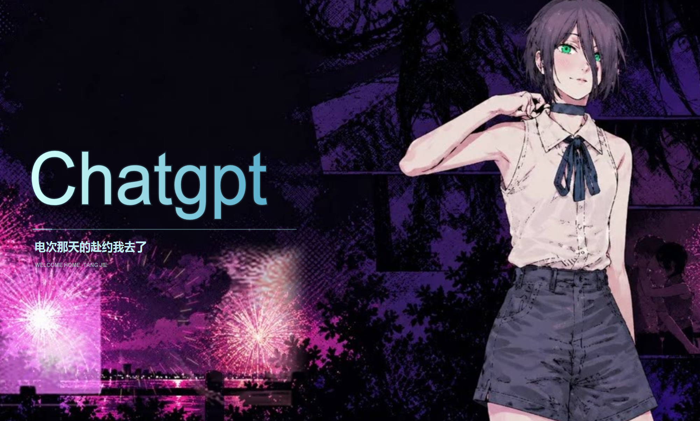

# 蕾塞的赴约 · Codex 启动器

Windows 桌面启动动画与 Codex 聊天窗口的平滑交接。支持 150% 等系统缩放、真实可见边框对齐，以及淡出期间的移动和尺寸变化检测。

这是非官方项目，与 OpenAI 无隶属或背书关系。

## 启动效果预览

下面是自定义蕾塞版的启动效果截图，由项目维护者提供。



聊天界面就绪后，启动器核对窗口边缘并在原位淡出。截图用于展示自定义效果；Releases 中的公开程序仍采用原创抽象演示动画。截图中的第三方人物素材不属于本项目 MIT 许可范围。

## 功能

- 210 帧启动动画，启动期间覆盖原生加载画面。
- 复用已经验证的 Dream Skin 会话，或调用其启动脚本。
- 聊天界面结构就绪后才开始窗口交接。
- 使用每显示器 DPI 感知和 DWM 可见边框测量。
- 淡出期间持续检查对齐；发现移动、缩放或不可见状态时重置淡出。
- 等待超时和诊断日志。

## 环境

- Windows 10/11，Windows PowerShell 5.1 和 .NET Framework 4.x。
- 已安装 Codex 桌面版。
- 已单独安装并配置 [Codex Dream Skin](https://github.com/Fei-Away/Codex-Dream-Skin)。启动器调用 `%LOCALAPPDATA%\CodexDreamSkin\engine\scripts` 下的脚本，依赖其状态格式和验证接口；上游升级可能需要适配。

## 构建与使用

在项目文件夹运行：

```powershell
powershell -NoProfile -ExecutionPolicy Bypass -File .\prepare-demo-assets.ps1
powershell -NoProfile -ExecutionPolicy Bypass -File .\build-launcher.ps1
.\CodexSeamlessLauncher.exe
```

第一步生成本项目原创的抽象渐变演示帧、动作占位图和通用图标。构建脚本验证嵌入帧包的哈希，然后生成可执行文件。使用 Releases 的 exe 时无需另行生成素材。

源码保留了自定义标题及中文台词，可在 `RezeTransitionLauncher.cs` 的 `DrawWelcome` 中修改。发布版没有个人姓名或本机路径。

需要自己的背景时，用你有权使用的资源替换 `intro-convergence.zip`（恰好 210 张、按文件名排序的图片）、`assets/reze-motion-keyframe.png`（1280×720）和 `assets/codex-black-transparent.ico`，再构建。资源文件名沿用本地版本以保持构建兼容。

## 验证

```powershell
.\CodexSeamlessLauncher.exe --test-wait
```

该模式只测试动画等待与淡出，不启动 Codex；结果写入 `transition-test.txt`。

`alignment-check.cs` 是使用临时窗口的对齐回归测试，覆盖初次对齐、12 次移动/尺寸变化、淡出重置以及隐藏窗口拒绝。测试需要交互式 Windows 桌面：

```powershell
& "$env:WINDIR\Microsoft.NET\Framework64\v4.0.30319\csc.exe" /nologo /target:winexe /out:alignment-check.exe /reference:System.Windows.Forms.dll /reference:System.Drawing.dll alignment-check.cs
.\alignment-check.exe
Get-Content .\alignment-check.txt
```

## 已知限制

启动动画是单独的覆盖窗口，不是修改 Codex 官方启动页。窗口在交接前需要稳定至少 200 毫秒，可见边缘容差为 1 个物理像素。操作系统焦点限制、其他置顶应用、上游变化及异常退出可能影响效果。默认等待就绪最长 90 秒，总流程最长 120 秒。冷启动时上游可能要求处理重启提示。

实际诊断在 `launcher-start.log`，不要未经检查公开日志或个人配置。Git 默认忽略这些文件。

## 许可与素材

代码和随仓库提供的原创抽象演示生成器使用 MIT 许可证，见 [LICENSE](LICENSE)。说明书中的自定义效果截图含第三方人物素材，仅作为效果展示，不授予其使用或再分发权。本项目不打包官方 OpenAI 图标、Codex 程序、第三方皮肤引擎或它们的安装包。第三方名称、商标及用户自行添加的素材不属于 MIT 授权范围，参见 [NOTICE.md](NOTICE.md)。
